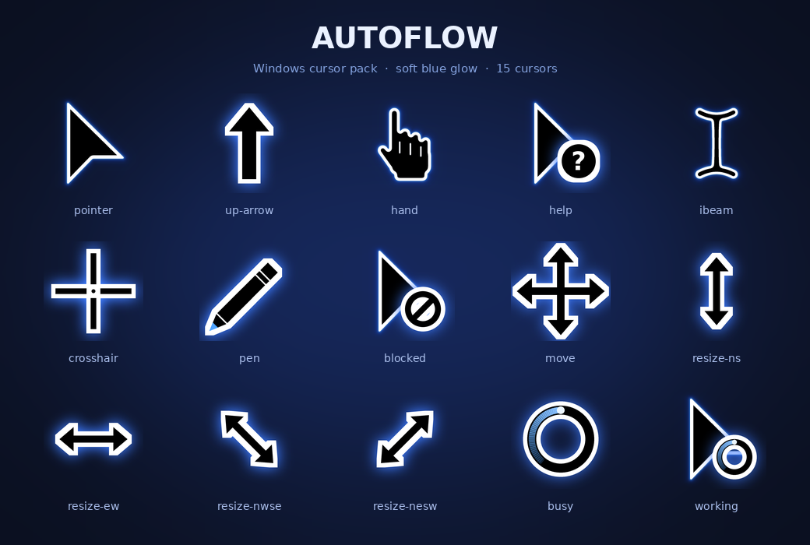

<div align="center">



# Autoflow

**A clean black cursor set with a soft blue glow for Windows, inspired by the OpenAI Codex cursor look.**

15 cursors · 2 animated · one-click install

</div>

---

## About

Autoflow is a Windows cursor theme (`.cur` / `.ani`) with a minimal black pointer, a crisp white outline and a soft blue glow. The style is inspired by the cursor used in OpenAI Codex, so if you were looking for a **Codex-style cursor pack for Windows**, this is it. It was designed and built together with Claude (Anthropic).

> Autoflow is an independent, fan-made project. It is not affiliated with, endorsed by, or sponsored by OpenAI. "Codex" and "OpenAI" are trademarks of their respective owners.

## Preview

| | Role | File |
|:-:|---|---|
|  | Normal Select | `autoflow-pointer.cur` |
|  | Help Select | `autoflow-help.cur` |
|  | Working in Background | `autoflow-working.ani` |
|  | Busy | `autoflow-busy.ani` |
|  | Precision Select | `autoflow-crosshair.cur` |
|  | Text Select | `autoflow-ibeam.cur` |
|  | Handwriting | `autoflow-pen.cur` |
|  | Unavailable | `autoflow-blocked.cur` |
|  | Vertical Resize | `autoflow-resize-ns.cur` |
|  | Horizontal Resize | `autoflow-resize-ew.cur` |
|  | Diagonal Resize 1 | `autoflow-resize-nwse.cur` |
|  | Diagonal Resize 2 | `autoflow-resize-nesw.cur` |
|  | Move | `autoflow-move.cur` |
|  | Alternate Select | `autoflow-up-arrow.cur` |
|  | Link Select | `autoflow-hand.cur` |

## Install (Windows 10 / 11)

1. Download or clone this repo, and **extract it** if you got a `.zip`.
2. Right-click **`install.inf`** → **Install**.
3. Open **Settings → Bluetooth & devices → Mouse → Additional mouse settings → Pointers**.
4. Pick the **Autoflow** scheme from the list and press **Apply**.

> The files are copied to `C:\Windows\Cursors\Autoflow`.

### Manual install

Open **Mouse properties → Pointers**, select a role (e.g. *Normal Select*), press **Browse…** and choose the matching file from this folder. Repeat for each role, then use **Save As…** to store the scheme.

## Uninstall

Open **Mouse properties → Pointers**, pick **Windows Default** (or any other scheme), then delete the `Autoflow` scheme and the folder `C:\Windows\Cursors\Autoflow`.

## Files

```
autoflow-cursors/
├── install.inf
├── autoflow-*.cur / .ani     # the 15 cursors
└── previews/                 # images used in this README
```

## License

Add your license of choice here (for example MIT) before publishing.
